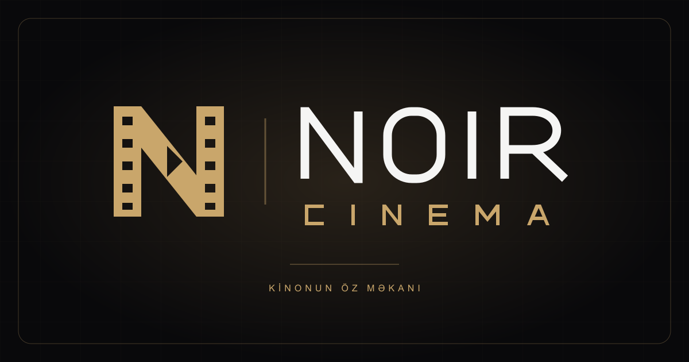

# Groq ilə NOIR AI

Vercel-də `GROQ_API_KEY` (yalnız serverdə) əlavə edin və bu dəyişikliyi deploy edin. Groq açarı varsa avtomatik seçilir; köhnə `GEMINI_API_KEY` seçimi dəyişmir. `GROQ_MODEL` standart olaraq `qwen/qwen3.8-27b`-dır. İstəyə görə `AI_PROVIDER=groq` və ya `AI_PROVIDER=gemini` ilə açıq seçim edin. Groq seçilib açar yoxdursa xidmət bağlı qalır; gizli provayder keçidi yoxdur.

Ziyarətçi çatı, film analizi, admin söhbəti, bağlantı sınağı və süjet tərcüməsi eyni seçilmiş provayderdən istifadə edir. Groq üçün JSON object rejimi və serverdə sxem yoxlaması var; tərcümə adi mətn istəyir. Natamam cavablar saxlanmır. Çatda uyğunluğa görə ən çox 20 filmin qısa məlumatı və son 8 mesajın qısaldılmış mətni göndərilir. Admin də qısa kolleksiya kontekstindən istifadə edir. Tam kolleksiyanın hamısı modelə göndərilmir. Mesajlar seçilmiş AI xidmətinə ötürülür.

Pulsuz planın sorğu/token/günlük limitləri var: 445 tərcümə dərhal tamamlanmaya bilər. Kvota bitərsə proses saxlanır, tamamlanan süjetlər qorunur. Admin → AI ilə söhbət → AI bağlantısını yoxla ilə real sorğu göndərərək sınaqdan keçirin. `/api/status` yalnız konfiqurasiyanı və provayder adını göstərir, açarı qaytarmır və uğurlu canlı sınaq demək deyil.

Rəsmi mənbələr: [Groq modelləri](https://console.groq.com/docs/models), [JSON rejimi](https://console.groq.com/docs/structured-outputs), [limitlər](https://console.groq.com/docs/rate-limits). Aşağıdakı Gemini ayarları yalnız Gemini ayrıca seçildikdə tətbiq olunur.

# NOIR CINEMA



Mövcud NOIR layihəsi üzərində hazırlanmış Azərbaycan dilli 3D kino otağı. Yeni, əlaqəsiz sayt yaradılmayıb.

## Loqo

Qızılı kino lentindən qurulmuş **N** monoqramı və mənfi sahədə **play** işarəsi. Yazılı loqo da vektor konturlarından hazırlanıb və xarici şrift tələb etmir. Loqo başlıqda, yüklənmə ekranında, admin girişində/panelində, AI avatarlarında, çat düyməsində və DVD qutularında istifadə olunur.

- `public/brand/noir-logo.svg`: şəffaf fonlu əsas vektor loqo
- `public/brand/noir-mark.svg`: tək monoqram
- `public/brand/noir-logo.png`: şəffaf PNG loqo
- `public/brand/noir-icon-512.png`: kvadrat ikon
- `public/favicon.svg`, `public/brand/favicon-32.png`: brauzer ikonları
- `public/brand/apple-touch-icon.png`: telefon üçün ikon
- `public/brand/noir-social.png`: 1200 × 630 paylaşım və GitHub social preview şəkli

## Hazırkı vəziyyət

- **İşləyir:** U formalı Three.js otağı, sağa-sola baxış, toxunma/sürükləmə, dik DVD qutuları, rəfdən çıxma, kameraya yaxınlaşma, üz qabığının açılması və 3D disk, məlumat paneli, axtarış, filtrlər, şəxsi seçimlər, sosial keçidlər.
- **Canlı yayım qurulub:** [noirfilms.vercel.app](https://noirfilms.vercel.app), Neon bazası, admin girişi və TMDB importu. Repo açarlar saxlamır; başqa yayım üçün öz server dəyişənlərinizi qurun.
- **Ayrıca admin studiyası:** `/admin.html` (və `/admin`), film/rəf idarəsi, sərbəst kino söhbəti, AI-siz TMDB axtarışı, import və Azərbaycan dilində süjetlərin tamamlanması.
- Gemini-nin real əlçatanlığı, hesab kvotası və 500/500 import statusu ayrıca yoxlanmalıdır. Yerli 12 nümunə canlı TOP 500 kimi göstərilmir.
- Mövcud `chatgpt.site` ünvanı **statik önbaxışdır**. Vercel funksiyalarını orada işlək kimi göstərmir. Eyni mənbə Vercel-də yayımlanmalıdır.

## Lokal işə salma

Node.js 22.12+ tövsiyə olunur.

```sh
npm install
npm run dev
npm test
npm run build
```

`npm run dev` həm Vite-ni, həm `/api` üçün eyni Vercel handler-inin lokal middleware-ni açır. `.env` yoxdursa, server açılır, amma canlı admin və provayderlər bağlı qalır. `npm run preview` yalnız statik build üçündür.

## Canlı bağlantıları qurmaq

1. [Neon](https://console.neon.tech/) hesabında PostgreSQL layihəsi yaradın və bağlantı sətrini götürün.
2. [TMDB](https://www.themoviedb.org/settings/api) hesabınızdan **API Read Access Token** alın.
3. [Groq Console](https://console.groq.com/) üzərindən Groq API açarı yaradın. Yalnız TMDB TOP 500 importu üçün AI açarı məcburi deyil; Azərbaycan dilində olmayan süjetlərin avtomatik tərcüməsi üçün lazımdır.
4. `.env.example` faylını `.env` kimi kopyalayın. Gizli dəyərləri yalnız həmin git-ə daxil edilməyən fayla və Vercel **Environment Variables** bölməsinə yazın. Açarları çata, frontend-ə və `VITE_` dəyişənlərinə yazmayın.

| Dəyişən                  | Təyinat                                                                  |
| ------------------------ | ------------------------------------------------------------------------ |
| `DATABASE_URL`           | Neon PostgreSQL bağlantı sətri                                           |
| `TMDB_READ_ACCESS_TOKEN` | TMDB Read Access Token                                                   |
| `GEMINI_API_KEY`         | NOIR AI və süjet tərcüməsi                                               |
| `GEMINI_MODEL`           | Standart `gemini-3.5-flash-lite`; hesabınızda əlçatan modeli seçin                |
| `GEMINI_FALLBACK_MODEL`  | 5xx/bağlantı xətasından sonra ehtiyat model; standart `gemini-3.8-flash`. Boş dəyər ehtiyat modeli söndürür; modelin tarif və kvotaları tətbiq olunur. |
| `ADMIN_USERNAME`         | Öz admin istifadəçi adınız                                               |
| `ADMIN_PASSWORD_HASH`    | Aşağıdakı əmrlə yaradılan scrypt heşi                                    |
| `ADMIN_SESSION_SECRET`   | Həmin əmrlə yaradılan təsadüfi sirr                                      |
| `APP_ORIGIN`             | Lokalda `http://localhost:5173`, production-da saytın tam HTTPS origin-i |

Admin şifrəsini terminalda gizli daxil edərək heş yaradın:

```sh
npm run admin:credentials
```

Əmr açıq şifrəni saxlamır. Çıxan heşi və sessiya sirrini `.env` və Vercel dəyişənlərinə əlavə edin. Ən azı 14 simvolluq güclü şifrə istifadə edin.

Neon bağlantısı əlavə edildikdən sonra:

```sh
npm run db:migrate
```

Miqrasiya orijinal UUID film cədvəlini də dəstəkləyir, təkrar işlədilə bilir və **heç bir nümunə filmi avtomatik bazaya yazmır**. Yenidən icra zamanı vaxtı bitmiş sessiyalar və limit qeydləri də təmizlənir.

## Vercel

Eyni repo/mənbəni Vercel layihəsinə bağlayın. Build əmri `npm run build`, çıxış `dist`. `vercel.json` Node funksiyalarını və 60 saniyəlik funksiya həddini elan edir; planınızın bunu dəstəklədiyini yoxlayın. Production dəyişənlərini Vercel-də əlavə edin və `APP_ORIGIN` dəyərini dəqiq production origin-ə dəyişin. Yeni deployment edin.

`/api/status` yalnız konfiqurasiya bayraqlarını qaytarır, sirləri qaytarmır. Admin paneli bazaya qoşulub `/api/catalog` uğurlu cavab verənədək real kolleksiya iddiası etmir. API konfiqurasiya olunsa da, miqrasiya və bağlantı ayrıca uğurlu olmalıdır.

Vercel üçün qısa yoxlama:

1. Layihə mənbəyini import edin; build `npm run build`, çıxış qovluğu `dist`.
2. `.env.example`-dəki dəyişənləri Vercel Environment Variables-a əlavə edin. Groq üçün `GROQ_API_KEY` və istəyə görə `GROQ_MODEL` istifadə olunur.
3. `APP_ORIGIN` dəyərini son sayt ünvanına, məsələn `https://noir-cinema.vercel.app` olaraq yazın; sonda `/` lazım deyil. Lokal önbaxışda isə `.env`-dəki origin və brauzerdəki origin eyni olmalıdır.
4. `npm run admin:credentials` ilə admin heşi və sessiya sirri yaradın. Lokal `.env`-də canlı Neon bağlantısını yazıb `npm run db:migrate` işlədin.
5. Vercel-də yeni deployment edin. Dişli işarəsindən adminə daxil olub film əlavə edin və ya TMDB importunu başladın. Sonra ziyarətçi çatını adminsiz yoxlayın.

## TOP 500: real və davam etdirilə bilən import

Admin hesabına daxil olun → **TOP 500 importu** → importu başladın.

- Mənbə TMDB-nin `movie/top_rated` endpoint-idir; bu **IMDb TOP 500 deyil**.
- Əvvəlcə 500 unikal TMDB ID-si və siyahının tarixi bazada sabitlənir. 500 ID alınmayanda import başlamır.
- Hər addım bir filmin rejissorunu, aktyorlarını, reytinqini, posterini və treylerini alır. 25 filmlik rəflər yaradılır.
- TMDB ID-si unikal olduğundan təkrar cəhdlər eyni filmi çoxaltmır. Aktiv import davam etdirilir.
- Brauzeri bağlamaq və ya dayandırmaq son təsdiqlənmiş addımı itirmir. Cari sorğu bitdikdən sonra dayanır.
- Davam etdirmək yeni import üçün saatlıq limiti istifadə etmir. Filmlər arasında ən azı 2.5 saniyə fasilə var; bu fasilə provayderin bütün kvotalarına zəmanət vermir.
- **İmport zamanı süjetləri AI ilə tərcümə et** seçimi standart olaraq bağlıdır. Beləliklə Gemini əlçatmaz olsa da, eyni importu TMDB ilə davam etdirmək mümkündür. Bu halda TMDB-nin Azərbaycan dilində süjeti saxlanır, digərləri boş/missing qalır. Seçim NOIR AI çatlarını söndürmür. Provayder uğursuzluqlarında Vercel Logs-a yalnız HTTP statusu və əməliyyat adı yazılır; açar, süjet, provayder cavabı və istifadəçi mesajı yazılmır.
- Gemini natamam və ya yanlış formatlı süjet qaytarsa, film digər məlumatlarla saxlanır, süjet boş və tərcümə statusu `missing` qalır; panel çatışmayan tərcümə sayını göstərir. Gemini kvotası və ya açar problemi importu saxlayır, son uğurlu addım qorunur. Yerli limitdə təxmini gözləmə müddəti göstərilir, 429 cavablarında `Retry-After` başlığı var.
- İki serverin eyni addımı paralel icra etməməsi üçün bazada vaxtlı iş kilidi var.
- TMDB-nin Azərbaycan dilində süjeti varsa istifadə olunur. Yoxdursa Gemini qoşulduqda tərcümə edilir. AI yoxdursa süjet boş saxlanır və interfeys tərcümənin hazır olmadığını bildirir; ingiliscə süjet Azərbaycan dili kimi göstərilmir.
- Sonradan AI qoşub importu yenidən başlatmaq çatışmayan tərcümələri tamamlayır; redaktorun yazdığı süjetlər qorunur.
- Yalnız bazada həmin importun **500 ayrı filmi** olduğu təsdiqlənəndə tamamlandı göstərilir. İmportdan film silinərsə status natamam olur.

## NOIR AI

Saytın teması qara/antrasit fon, isti qızılı vurğular və 3D DVD kino arxividir. Həm ziyarətçi, həm admin üçün eyni üslubda mesaj balonları, hazır sorğular və posterli film kartları olan çat hazırlanıb. AI provayderi `GROQ_API_KEY` varsa **Groq**-dur. `GROQ_MODEL` ilə model dəyişdirilə bilər; standart `qwen/qwen3.8-27b`-dır. Gemini yalnız ayrıca seçildikdə və ya Groq açarı olmadıqda istifadə olunur. Açarlar yalnız serverdə saxlanır.

**Saytdakı çat:** menyudakı **NOIR AI**, sağ altdakı **Bir film tapaq**, yaxud film məlumatındakı **Oxşar filmləri tap** düyməsindən açılır. Admin girişi tələb etmir. İstifadəçi sevdiyi filmi, janrı və ya əhvalını yazır; AI canlı kolleksiyadan ən çox 4 film və qısa səbəblər təklif edir. Film kartına toxunanda onun məlumatları açılır. Film səhifəsindən açılan çat seçilmiş filmi nəzərə alır. Çat bazaya yazmır; qaytarılan film ID-ləri serverdə kolleksiya ilə yoxlanılır. Son 8 mesaj sorğuya daxil edilir, söhbət daimi yaddaşa yazılmır. Mesajlar seçilmiş AI xidmətinə göndərilir.

**Admin studiyası:** birbaşa `/admin.html` ünvanında təhlükəsiz admin hesabı ilə daxil olun. **AI ilə söhbət** film əlavə etmə, toplu əlavə etmə, rejissor seçimi və metadata yeniləməsi üçün TMDB məlumatları ilə imzalanmış təsdiq siyahısı hazırlayır. **Təsdiqlə və icra et** seçilmədən film yazılmır. Hər nəticə real backend cavabından göstərilir. Aşağıdakı “AI admin əməliyyatları” bölməsinə baxın.

**AI olmadan əlavə etmək:** **Film əlavə et** bölməsi birbaşa TMDB-də axtarır. Burada Gemini çağırılmır. Açıqlamaları **Azərbaycan dilində süjetlər → Çatışmayan süjetləri tamamla** ilə tərcümə edin və ya film redaktorunda yazın. Tərcümə bir filmə bir sorğu ilə, fasilələrlə gedir; xəta və ya dayandırma son tamamlanan filmləri itirmir. Mövcud açıqlamalar yenidən yazılmır. Google əlçatmazdırsa tərcümənin tamamlandığı iddia edilmir.

**Xidmət xətaları:** Groq üçün 5xx və bağlantı xətalarında ən çox 3 cəhd və ümumi 42 saniyə həddi var. 429, giriş və sorğu xətaları təkrarlanmır; başqa provayderə avtomatik keçilmir. Xidmətin işləməsinə zəmanət verilmir. Gemini ayrıca seçilərsə əvvəlki ehtiyat model mexanizmi qalır.

Film analizi də ziyarətçilərə açıqdır. Açıq AI sorğuları eyni origin-dən qəbul olunur, Neon-da hər IP üçün saatda 15 və bütün sayt üçün gündə 200 sorğu ilə məhdudlaşır. Gündəlik hədd provayderin pul büdcəsi deyil; Gemini hesabının öz kvota və xərclərini ayrıca idarə edin. Admin yazma əməliyyatları sessiya və CSRF tələb etməyə davam edir. Bütün cavablar üçün Azərbaycan dili təlimatı verilir. Provayder nəticəsi gəlmədikdə saxta AI cavabı göstərilmir. Yerli alternativlər ayrıca janra əsaslanan seçim kimi işarələnir. Çatın canlı işləməsi üçün Neon miqrasiyası və seçilmiş AI xidmətinin açarı lazımdır; admin film əlavə etmək üçün TMDB də qoşulmalıdır.

## İdarəetmə və təhlükəsizlik

Film CRUD-u, poster keçidi, rəfə təyinetmə, film sıralaması, rəf yaratma/adını dəyişmə/sıralama/silmə var. Silinmiş rəfin filmləri bir tranzaksiya içində əsas rəfə köçürülür. Əsas rəfi silmək olmaz.

Şifrələr scrypt heşi ilə yoxlanır. Sessiya 8 saatlıq HttpOnly, production-da Secure, SameSite=Strict kukidədir; bazada yalnız tokenin HMAC-i saxlanır. Çıxış server sessiyasını ləğv edir. Yazma əməliyyatları origin və CSRF yoxlamasından keçir. Login, admin və AI limitləri Neon-da saxlanır; serverless instance yaddaşına güvənilmir. SQL parametrli sorğulardır. Admin dəyişiklikləri audit cədvəlinə yazılır. Sorğu ölçüsü və xarici API vaxt hədləri var. Server xətaları SQL və provayder sirlərini brauzerə çıxarmır.

## Quruluş

- `src/room.js`: Three.js otağı, DVD menteşəsi/disk, kamera, raycasting, tekstura keşi
- `src/main.js`: ümumi Azərbaycan dilli interfeys və açıq şəkildə işarələnmiş yerli demo
- `src/admin.js`, `src/api.js`: canlı admin və server rabitəsi, CSRF yalnız sessiya yaddaşında
- `server/handler.js`: Vercel və lokal dev üçün eyni API router
- `server/auth.js`, `server/http.js`, `server/db.js`: sessiya, doğrulama, HTTP və Neon
- `server/repository.js`: film/rəf SQL əməliyyatları
- `server/tmdb.js`, `server/ai.js`, `server/importer.js`: provayderlər və TOP 500 prosesi
- `src/chat.js`, `src/chat.css`, `server/chat.js`: ziyarətçi/admin çat dizaynı, Gemini tövsiyələri və açıq AI limitləri
- `admin.html`, `src/admin-page.js`, `src/admin-page.css`: ayrıca admin studiyası; `server/admin-assistant.js`, `server/gemini.js`: söhbət və məhdud provider təkrarları
- `server/schema.sql`, `scripts/`: miqrasiya və gizli şifrə daxil etmə aləti
- `tests/`: təhlükəsizlik, sessiya, TMDB adapteri və real lokal PostgreSQL mühərriki (PGlite) ilə SQL testləri

## İdarəetmə və performans

Janr filtri çoxjanrlı filmləri hər janr üzrə ayrıca tapır; yerli redaktordan sonra da siyahı yenilənir. Şəxsi kolleksiyadakı film cari filtrdən kənardadırsa, **Açılmış 3D qutuya bax** filtrləri təmizləyib həmin qutunu açır. Qutu açılarkən dialoq bağlanarsa, gecikmiş animasiya cavabı onu yenidən açmır.

Sürükləyin və ya sol/sağ oxlarla baxın; qutuya klikləyin/toxunun; Escape və ya **Rəfə qaytar** ilə geri dönün. **Açılmış 3D qutuya bax** qutunu məlumat paneli olmadan göstərir. **Otağı böyüt** interfeysi geniş otaq rejiminə keçirir.

Böyük kolleksiya 108 filmlik otaq bölmələrinə ayrılır. Qutular ön üzü görünən vəziyyətdə düzülür. Cari bölmənin bütün posterləri dörd paralel yükləmə ilə alınır; 128 teksturalıq keş hazırda istifadə olunan posterləri silmir. TMDB şəkilləri mobildə w185, böyük ekranda w342 ölçüsündədir. Bütün 500 poster eyni vaxtda GPU-ya yüklənmir. Poster çatışmırsa yerli başlıq təsviri qalır. Pixel ratio mobildə 1.35 ilə məhdudlaşır. Boşdayanma, gizli vərəq və siyahı rejimində render dayanır; mobil aktiv animasiyalar təxminən 30 FPS həddi ilə işləyir. Faktiki FPS cihazdan asılıdır.

Testlərdə TMDB/Gemini xarici cavabları fixture-lərlə əvəz olunur; bu, canlı API yoxlaması deyil. PostgreSQL SQL və sessiya testləri uğurla keçsə də, hesablar qoşulduqdan sonra real Neon/Vercel/TMDB üzərində ayrıca qəbul sınağı tələb olunur.

## Məlumat mənbələri

Nümunə posterlərinin hüquqları müvafiq sahiblərinə məxsusdur. Manrope Google Fonts-dan yüklənir. TMDB-dən canlı məlumatlar alınanda reytinq mənbəyi ayrıca TMDB göstərilir. Nümunə IMDb reytinqləri canlı yenilənmir.

Rəsmi sənədlər: [Neon driver](https://github.com/neondatabase/serverless), [TMDB Top Rated](https://developer.themoviedb.org/reference/movie-top-rated-list), [TMDB autentifikasiyası](https://developer.themoviedb.org/docs/authentication-application), [Vercel Node funksiyaları](https://vercel.com/docs/functions/runtimes/node-js), [Gemini Structured Outputs](https://ai.google.dev/gemini-api/docs/structured-output).


### Tərcümə sürəti və 429

Toplu tərcümələr arasında 15 saniyə fasilə var. 429 zamanı serverin `Retry-After` müddəti 120 saniyəyədəkdirsə panel geri sayır və həmin filmi yalnız bir dəfə təkrar yoxlayır. Dayandır və Geri düymələri gözləməni ləğv edir. Gündəlik sorğu limiti Groq başlığında bitmiş göstərilirsə və ya uzun fasilə tələb edilirsə avtomatik təkrar yoxdur. İkinci 429 prosesi saxlayır. Natamam/yanlış cavablı filmlər sonrakı yoxlama üçün buraxılır; mövcud süjetlər dəyişdirilmir. Fasilə bütün hesabın token və günlük limitlərinə zəmanət vermir; sayt çatı da eyni Groq hesabının limitindən istifadə edir. AI ilə importda da 15 saniyə, yalnız TMDB importunda 2,5 saniyə fasilə var.


### Sayt daxilində treyler

Film məlumatında **Treylerə bax** düyməsi NOIR pəncərəsində YouTube pleyerini açır; ayrıca YouTube səhifəsinə keçid verilmir. Pleyer yalnız düyməyə basıldıqda yüklənir, tam ekran və mobil inline baxış dəstəklənir. Treyleri bağlamaq, film pəncərəsini bağlamaq və ya 3D qutuya qayıtmaq iframe-i silərək səsi də dayandırır. Treyler ID-si yoxdursa düymə bağlıdır. Video sahibinin embed və region məhdudiyyətləri yenə tətbiq olunur; bütün videoların oynadılmasına zəmanət verilmir.


### Posterə uyğun film rəngləri

Siyahıdan və ya 3D rəfdən film açıldıqda posterin kiçik nüsxəsindən əsas və ikinci rəng seçilir. Arxa fon, sol poster hissəsi, sağ məlumat hissəsi və treyler sahəsi bu rənglərin tünd tonlarına uyğunlaşır; mətn açıq saxlanır. Analiz brauzerdə aparılır, AI sorğusu yoxdur. Ən çox 96 poster palitrası yaddaşda saxlanır. Poster yüklənməzsə, CORS icazəsi yoxdursa və ya rəng alınmazsa standart tünd palitra göstərilir. Gecikmiş poster cavabı başqa filmə və ya çata rəng tətbiq etmir; pəncərə bağlananda rənglər təmizlənir.


## AI admin əməliyyatları

Admin çatında Groq/Gemini native function calling ilə `prepare_film_additions`, `prepare_director_additions` və `prepare_film_update` alətləri var. Model yalnız serverdə əvvəlcədən müəyyən edilmiş bu alətləri seçir; SQL və ya database/API açarları modelə verilmir. Bir əmrdə ən çox 10 film hazırlanır.

Məsələn: “Uzak (2002) — Nuri Bilge Ceylan filmini əlavə et”, “Bu 4 filmi kolleksiyaya əlavə et”, “Christopher Nolanın 10 filmini əlavə et”, “Uzak (2002) filminin məlumatlarını yenilə”. “Bu film” və ya “bu 4 film” tarixçədən dəqiq müəyyən edilmirsə ad/il dəqiqləşdirilməlidir. Rejissor seçimi TMDB-də yalnız Director kreditlərinə əsaslanır; uyğun filmlər populyarlıqla sıralanır.

AI əvvəlcə TMDB-dən orijinal ad, il, rejissor və metadata ilə təsdiq siyahısı hazırlayır; bu addım filmlərə yazmır. Uyğunluq qeyri-müəyyəndirsə film avtomatik seçilmir. Artıq mövcud filmlər və bu sorğudakı təkrarlar ayrıca göstərilir. “Təsdiqlə və icra et” backend-in hər filmi ayrıca yazmasına başlayır. Təsdiq 15 dəqiqəlik imza ilə həmin admin sessiyasına bağlanır; hər `/api/admin/assistant/confirm` sorğusu autentifikasiya, CSRF və origin yoxlamasından keçir. İmzalanmış siyahı dəyişdirilə bilməz.

Əlavə etmə TMDB unique indeksi ilə təkrara qarşı qorunur və orijinal ad/il də mövcud filmlərlə yoxlanılır. Yeniləmə rəfi, sıralamanı və mövcud süjeti saxlayır; təsdiqdən sonra film başqa yerdə dəyişərsə əməliyyat 409 ilə dayanır. Yazma və audit bir SQL ifadəsində aparılır. UI yalnız həqiqi backend nəticələrini göstərir; qismən uğursuzluqlar ayrı yazılır. Bu əməliyyatlarda AI süjet tərcüməsi çağırılmır, kvota xətası metadata əlavə etməyi saxlamır. Açıq sayt admin dəyişiklik bildirişində və geri qayıdarkən kolleksiyanı yenidən oxuyur, açıq film/3D baxışını yarıda kəsmir. Yeni sxem miqrasiyası tələb olunmur.
